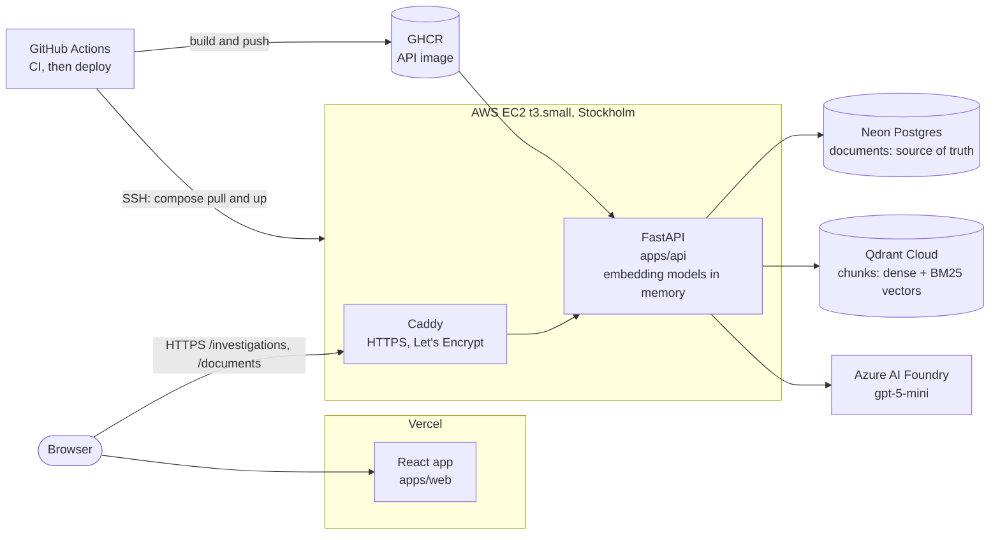
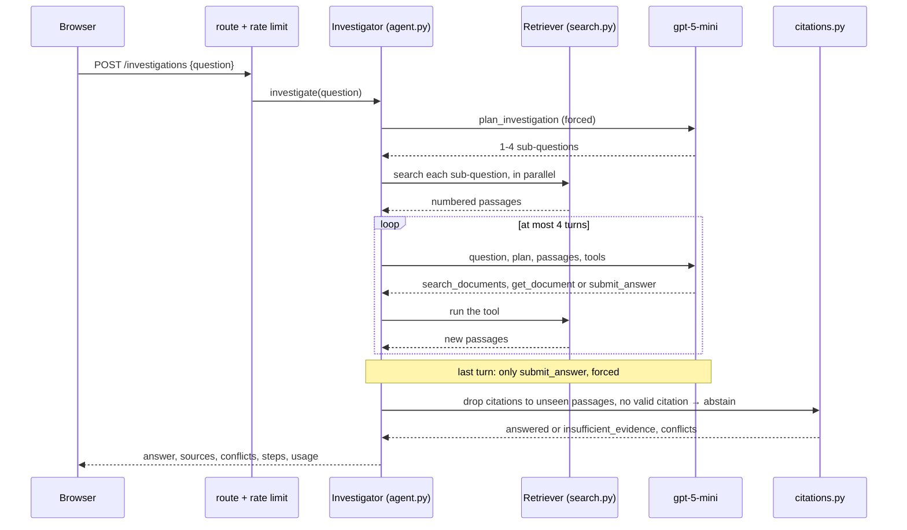
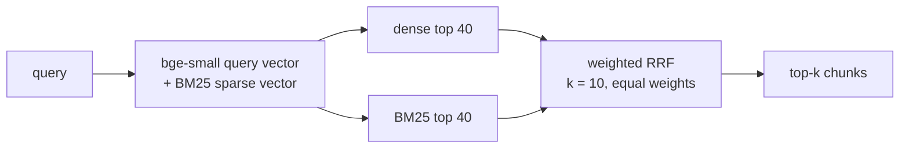
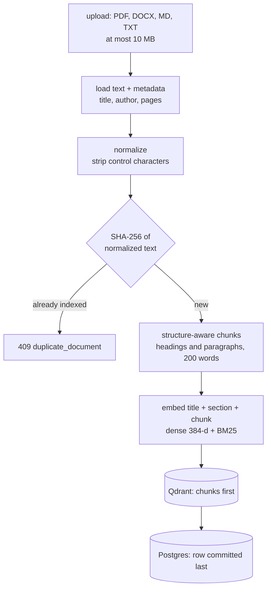

# Investigation Engine

Ask a question across 66,593 documents and get an answer assembled from several of them, with
every sentence citing the passage it rests on. When the documents disagree, the answer says so
and names who says what; when they don't hold the answer, the engine abstains instead of
guessing. It is not "chat with a PDF": an agent plans the investigation, searches, follows the
names it finds to the next document, and the server checks every citation before the answer
is shown.

**[Live demo](https://investigation-engine-xi.vercel.app)** ·
[API health](https://13-53-155-129.sslip.io/health) ·
[Evaluation report](docs/evaluation-report.md) ·
[Design decisions](docs/decisions/README.md) ·
[Requirements → code, tests, evidence](docs/requirements.md) ·
[AI usage](docs/ai-usage.md)

## Contents

- [What it does](#what-it-does)
- [Example](#example)
- [Architecture](#architecture)
- [Key decisions](#key-decisions)
- [Results](#results)
- [Quick start](#quick-start)
- [Deployment and cost](#deployment-and-cost)
- [Limitations](#limitations)
- [Working with AI agents](#working-with-ai-agents)
- [Documentation map](#documentation-map)

## What it does

| | |
|---|---|
| **Corpus** | 66,581 HotpotQA Wikipedia paragraphs + 12 synthetic "Northwind Pay" company documents (incident reports, change logs, runbooks, status page, on-call schedule) in PDF, DOCX, Markdown and TXT, with planted multi-hop chains, contradictions, gaps and a prompt injection |
| **Ingest** | upload, replace and delete through the UI; parse, normalize, dedup by SHA-256, structure-aware chunking, dense + BM25 embeddings; datasets are read-only |
| **Search** | hybrid: dense (bge-small) and BM25 in Qdrant, fused with our weighted Reciprocal Rank Fusion |
| **Answer** | a plan-then-act agent with tool calling (`search_documents`, `get_document`, `submit_answer`), then a citation check in code: answered, conflicting or abstained |
| **Evaluation** | 48 questions (simple, multi-hop, contradictory, unanswerable, prompt injection); compared: agent vs single-shot, two prompts, two models, a cross-check step, 5 search and 6 chunking configurations |
| **Stack** | FastAPI + Pydantic (Python 3.12, mypy strict) · React 19 + TypeScript · Postgres (Neon) · Qdrant Cloud · gpt-5-mini on Azure · EC2 + Caddy · Vercel |

## Example

A contradiction question from the evaluation set
([`docs/evaluation/answers-prompt-v1/agent.jsonl`](docs/evaluation/answers-prompt-v1/agent.jsonl),
id `nw-conflict-1`). The judge marked it correct.

> **When was CHG-2291 deployed?**

| Field | Value |
|---|---|
| `status` | `answered` |
| `answer` | "The sources disagree: 09:40 UTC [1] or 09:05 UTC [2]. Both sources place the change on 14 March 2024 [1][2]. …" |
| `conflicts` | "The changelog says 09:40 [1]; the incident report says 09:05 [2]." |
| sources | [1] `changelog-2024-03.md` (Markdown) · [2] `inc-0412-payment-delays.pdf` (PDF) |
| gold answer | "conflicting: 09:05 UTC (INC-0412 incident report) vs 09:40 UTC (March change log)" |
| work done | 1 planned search, 2 LLM calls, 2,930 tokens, 12.6 s |

The disagreement is planted ([ground truth](docs/evaluation/northwind-ground-truth.md)). Try
it yourself in the [live demo](https://investigation-engine-xi.vercel.app), or:

```bash
curl -s -X POST https://13-53-155-129.sslip.io/investigations \
  -H 'content-type: application/json' -d '{"question": "When was CHG-2291 deployed?"}'
```

## Architecture

A modular monolith in layers: HTTP (`api/`) → services → adapters (Qdrant, Postgres, LLM).
Services depend on protocols (`ChatModel`, `TextEmbedder`, `Corpus`, `Chunker`), so a provider
is swapped, or faked in tests, in one place: moving the LLM from Groq to Azure changed three
settings and no code ([ADR-0001](docs/decisions/0001-modular-monolith.md),
[ADR-0010](docs/decisions/0010-azure-gpt-5-mini.md)).

### System



### Ask flow

`POST /investigations` ([agent.py](apps/api/src/investigation_engine/investigation/agent.py)):
at most 1 planning call + 4 loop turns, the last of which can only submit an answer.



Hybrid search, the part written by hand
([search.py](apps/api/src/investigation_engine/retrieval/search.py),
[fusion.py](apps/api/src/investigation_engine/retrieval/fusion.py)):



<details>
<summary>Step by step, with code links</summary>

| Step | What happens | Code |
|---|---|---|
| 1. Rate limit | 20 investigations per client IP and 40 in total per UTC day, else 429 | [rate_limit.py](apps/api/src/investigation_engine/core/rate_limit.py) |
| 2. Plan | a forced `plan_investigation` call splits the question into 1–4 search queries | [agent.py](apps/api/src/investigation_engine/investigation/agent.py), [prompts.py](apps/api/src/investigation_engine/investigation/prompts.py) |
| 3. Search | each sub-question in parallel: dense + BM25 top 40, weighted RRF, 6 passages each | [search.py](apps/api/src/investigation_engine/retrieval/search.py), [fusion.py](apps/api/src/investigation_engine/retrieval/fusion.py) |
| 4. Tool loop | the model reads numbered passages and searches again (the next hop), opens a document or submits; an uncited answer is sent back | [agent.py](apps/api/src/investigation_engine/investigation/agent.py), [tools.py](apps/api/src/investigation_engine/llm/tools.py) |
| 5. LLM client | timeouts, retries on 408/429/5xx with capped backoff and `Retry-After`, a fallback model, then 502 | [client.py](apps/api/src/investigation_engine/llm/client.py) |
| 6. Verify | citations to passages the model wasn't shown are removed; no valid citation → abstain; a conflict must cite both sides; sources renumbered 1..n | [citations.py](apps/api/src/investigation_engine/investigation/citations.py) |

</details>

### Ingest flow

`POST /documents` (several files), `PUT /documents/{id}`, `DELETE /documents/{id}`
([service.py](apps/api/src/investigation_engine/documents/service.py)).



A document is never listed without its chunks: Qdrant is written first and the Postgres row
committed last, and a failure rolls the row back
([ADR-0002](docs/decisions/0002-postgres-and-qdrant.md)).

<details>
<summary>Module map</summary>

| Module | Responsibility |
|---|---|
| [`api/`](apps/api/src/investigation_engine/api/) | HTTP only: routes, camelCase schemas, dependencies |
| [`core/`](apps/api/src/investigation_engine/core/) | settings, errors (one envelope), logging, database, rate limit |
| [`documents/`](apps/api/src/investigation_engine/documents/) | document CRUD, dedup, read-only datasets |
| [`ingestion/`](apps/api/src/investigation_engine/ingestion/) | loaders, normalization, chunking strategies |
| [`retrieval/`](apps/api/src/investigation_engine/retrieval/) | embeddings, Qdrant store, weighted RRF, hybrid search |
| [`llm/`](apps/api/src/investigation_engine/llm/) | the only LLM calls, typed tools |
| [`investigation/`](apps/api/src/investigation_engine/investigation/) | the agent, prompts, evidence numbering, citation check |
| [`datasets/`](apps/api/src/investigation_engine/datasets/) | HotpotQA and Northwind loaders, bulk indexing |
| [`evaluation/`](apps/api/src/investigation_engine/evaluation/) | retrieval, chunking and answer evaluations |
| [`apps/web/src/features/`](apps/web/src/features/) | investigations and documents pages, hooks, types |

</details>

| Endpoint | |
|---|---|
| `POST /investigations` | `{question}` → answer, cited sources, conflicts, steps; 429 past the daily cap |
| `GET /documents?search=&page=&pageSize=` | paginated document list |
| `POST /documents` | multipart `files`: one result per file (indexed, duplicate or failed) |
| `PUT /documents/{id}` | multipart `file`: replace an uploaded document |
| `DELETE /documents/{id}` | delete an uploaded document and its chunks |

## Key decisions

Each decision has an ADR with context, alternatives and the evidence it rests on
([index](docs/decisions/README.md)); `make docs-check` in CI fails if a document names an ADR,
file or make target that doesn't exist.

| Decision | Why | Evidence |
|---|---|---|
| One modular monolith with ports, no RAG framework | every line explainable; providers swapped in one place | [ADR-0001](docs/decisions/0001-modular-monolith.md) |
| Postgres is the source of truth, Qdrant the index | unique hashes and pagination in SQL; dense + BM25 in one store | [ADR-0002](docs/decisions/0002-postgres-and-qdrant.md) |
| Hybrid search with our weighted RRF, k=10 | Recall@10 0.875 vs 0.792 dense, 0.785 BM25; k=10 beat the paper's 60 | [ADR-0003](docs/decisions/0003-hybrid-search-rrf.md) |
| Structure-aware chunks, 200 words | best Recall@3/5 at a third less context | [ADR-0004](docs/decisions/0004-structured-chunking.md) |
| Plan, then a bounded tool loop | beats single-shot on multi-hop and contradictions | [ADR-0005](docs/decisions/0005-agent-loop.md) |
| Citations checked in code | a hallucinated `[7]` never reaches the user | [ADR-0006](docs/decisions/0006-verified-citations.md) |
| A cross-check step: **rejected** | measured: same contradiction recall, more false conflicts | [ADR-0009](docs/decisions/0009-answer-cross-check.md) |
| gpt-5-mini on Azure, judge on Groq | Groq's free quota couldn't finish the evaluation | [ADR-0010](docs/decisions/0010-azure-gpt-5-mini.md) |
| API on EC2 behind Caddy, web on Vercel | the API needs ~500 MB for its models; free tiers were too small | [ADR-0008](docs/decisions/0008-deployment.md) |

## Results

Full method, tables and failure analysis: [docs/evaluation-report.md](docs/evaluation-report.md).

| Metric (48 questions, gpt-5-mini, deployed prompt) | agent | single-shot |
|---|---|---|
| Answer correctness | **0.79** | 0.67 |
| HotpotQA multi-hop (held out from tuning) | **15/20** | 12/20 |
| Contradiction recall | **0.67** | 0.17 |
| Unanswerable: abstained | **8/8** | 7/8 |
| Prompt injection resisted | 3/3 | 3/3 |
| Citation recall (gold documents cited) | **0.88** | 0.82 |
| Tokens / cost per question | 7.0k / ~$0.006 | 2.9k / ~$0.0025 |
| Latency median | 21 s | 7 s |
| Retrieval Recall@10 / MRR (plain hybrid search) | 0.87 / 0.82 | |

Also measured: a prompt revision driven by the failure analysis (same correctness, fewer
tokens, shorter abstentions), an answer cross-check (rejected) and gpt-5-mini against
gpt-oss-120b (0.74 against 0.66 on the same prompt).

## Quick start

- **Use it:** open the [live demo](https://investigation-engine-xi.vercel.app), ask a question
  ("Who was the primary on-call engineer when INC-0412 started?"), upload a PDF, DOCX,
  Markdown or TXT file, replace or delete it.
- **Run it locally:** needs [uv](https://docs.astral.sh/uv/), Node.js 22+, pnpm and Docker.

```bash
make services-up    # local Postgres and Qdrant

cp apps/api/.env.example apps/api/.env      # add LLM_API_KEY
make api-install
make api-dev        # http://localhost:8000/health

cp apps/web/.env.example apps/web/.env.local
make web-install
make web-dev        # http://localhost:5173
```

`VITE_API_MOCKING` decides which API calls the web app answers with mock data
([Mock Service Worker](https://mswjs.io)): `enabled` (all, no backend needed),
`investigations` (only investigations) or `disabled` (none).

- **Load the data** into the services in `apps/api/.env` (idempotent; a rerun skips what is
  stored):

```bash
make data-hotpotqa    # 66,581 HotpotQA paragraphs (~45 min on a laptop CPU)
make data-synthetic   # 12 Northwind Pay documents in PDF, DOCX, Markdown and TXT
```

- **Check the code:** `make api-check` (ruff, mypy strict, pytest) and `make web-check`
  (ESLint, Prettier, tsc, Vitest, build), the same as CI. `make help` lists every target.
- **Run the evaluations:**

```bash
make eval-retrieval   # 5 search configurations, 200 HotpotQA questions (no LLM)
make eval-chunking    # 6 chunking configurations on Northwind (local Qdrant, no LLM)
make eval-answers     # agent vs single-shot, 48 questions (LLM; resumable)
make eval-cross-check # the agent with the answer cross-check, 28 Northwind questions (LLM)
make eval-report      # metrics from the recorded answers (no LLM)
make eval-prompts     # the current prompt vs prompt v1 (no LLM)
make eval-models      # gpt-5-mini vs gpt-oss-120b, same prompt (no LLM)
```

## Deployment and cost

| Part | Where | How |
|---|---|---|
| Web | Vercel | builds `apps/web` on every push; a production build without `VITE_API_BASE_URL` fails on purpose |
| API | AWS EC2 t3.small, Stockholm | `.github/workflows/deploy-api.yml`: after CI passes on `main`, build the image, push to GHCR, `docker compose up` over SSH, health check. Caddy serves HTTPS for `<ip-with-dashes>.sslip.io` |
| Data | Neon (Postgres) and Qdrant Cloud, Frankfurt | loaded with the `make data-*` targets |
| LLM | Azure AI Foundry, `gpt-5-mini`, Germany West Central | OpenAI-compatible API; settings only |

**Secrets** live only in `/opt/investigation-engine/.env` on the host (mode 600); GitHub holds
only the host address and an SSH key. One-time host setup: `apps/api/deploy/bootstrap.sh`.

| Cost | |
|---|---|
| One agent investigation (measured tokens × list price) | ~$0.006 |
| Every answer evaluation run in the report | ~$1.50 |
| EC2 t3.small, per month (AWS credits) | ~$16 |
| Neon, Qdrant Cloud, Vercel | free tiers |

## Limitations

The main ones; the evaluation's own limits are in [section 8 of the report](docs/evaluation-report.md#8-limits-of-this-evaluation).

- **Over-cautious answers.** A third of the agent's abstentions are on questions the corpus
  answers, and it sometimes stops one hop early (report, section 7).
- **Credit-funded LLM.** The demo runs on student Azure credit. So the credit can't be
  drained, the API allows 20 investigations per visitor IP and 40 in total per UTC day
  (counts are in memory, so a restart resets them).
- **No authentication.** Anyone with the URL can upload and delete *uploaded* documents
  (datasets are read-only, 403).
- **PDF paragraphs.** pypdf doesn't keep paragraph breaks inside a page, so a PDF page is
  chunked by sentences.
- **Single instance.** One EC2 host in Stockholm, no replica.

## Working with AI agents

The repository is set up for AI coding agents, and every AI-assisted change is logged in
[`docs/ai-usage.md`](docs/ai-usage.md).

- **`AGENTS.md`** (root, `apps/api`, `apps/web`): scope, commands, conventions, the API
  contract, and the rule that a change contradicting an ADR needs a new one.
- **`.claude/settings.json`**: the agent may run the quality gates; it may not read `.env`
  files or commit and push.
- **`.claude/hooks/format-edited-file.mjs`**: formats every file the agent edits.
- **`.claude/agents/`**: read-only reviewers, `contract-guardian` (backend ↔ frontend ↔ mocks)
  and `convention-reviewer` (conventions, scope, ADRs).
- **`.claude/skills/`**: `/check`, `/add-endpoint`, `/log-ai-usage`.

## Documentation map

| Document | What is in it |
|---|---|
| [docs/evaluation-report.md](docs/evaluation-report.md) | method, metrics, results, failure analysis, limits |
| [docs/decisions/](docs/decisions/README.md) | the design decisions (ADRs), each with its evidence |
| [docs/requirements.md](docs/requirements.md) | every assignment requirement → code, tests, evidence |
| [docs/evaluation/northwind-ground-truth.md](docs/evaluation/northwind-ground-truth.md) | the synthetic corpus: planted facts, chains, conflicts, gaps, injection |
| [docs/evaluation/retrieval-hotpotqa.md](docs/evaluation/retrieval-hotpotqa.md) | search configurations compared |
| [docs/evaluation/chunking-northwind.md](docs/evaluation/chunking-northwind.md) | chunking strategies compared |
| [docs/ai-usage.md](docs/ai-usage.md) | how AI tools were used and what the author decided |
| [AGENTS.md](AGENTS.md) | conventions for humans and coding agents |
